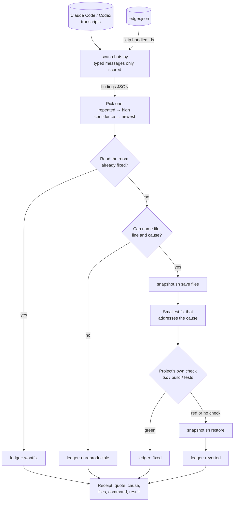

# Bug Sweeper Agent

A Claude Code loop that reads your past agent transcripts, finds the bugs you mentioned in passing and never came back to, fixes one per run, and reverts the fix if the project's own build or tests fail.

## Why

During long agent sessions you say "the screen is black" or "it won't let me press enter" while doing something else. The session moves on and the complaint dies there. Nobody files a ticket for it. This loop is the ticket system that files itself: it mines what you typed, picks the most neglected complaint, and repairs it with the same rigor you would want from a careful teammate. One bug actually fixed and verified beats four plausible-looking edits.

## Features

- **Transcript scanner** (`bin/scan-chats.py`) that walks `~/.claude/projects/*/*.jsonl` and, if present, Codex CLI history, and emits structured findings: `id`, `project` (the session's cwd), `quote`, `confidence`, `repeatedLater`, `likelyResolvedInSession`, `transcript`.
- **Only words you typed count.** Messages need `promptSource: typed | queued | suggestion_accepted`; tool results and injected context are ignored. `entrypoint: sdk-cli` sessions are excluded, so the sweeper never reads its own headless runs and reports its output back to itself.
- **Weighted scoring, not keyword matching.** Strong signals ("doesn't work", "crash", "screen is blank") score 2, weak ones ("weird", "missing") score 1, and idioms that merely contain a signal word ("break this down", "error handling", "no problem") subtract 2. A finding must reach a threshold.
- **Only the first 400 characters are scored**, because people lead with the complaint and paste logs after it. Scoring whole messages let a pasted error log outrank a real complaint.
- **Repeat and resolution detection.** A complaint you repeated later in the same session ranks first; one followed by "works now" or "perfect" is flagged as probably resolved.
- **Ledger** (`bin/ledger.py`) with five terminal states: `fixed`, `reverted`, `unreproducible`, `wontfix`, `needs-user`. The scanner skips every ledgered id, which is what makes the loop terminate.
- **Snapshot-based revert** (`bin/snapshot.sh`) that copies exactly the files about to be edited and restores exactly those. It works in folders that are not git repos and never discards the user's other uncommitted work, unlike a bulk `git checkout .`.
- **Loop spec** (`spec/bug-sweeper.md`) that tells the agent how to pick, reproduce, fix, verify, revert and ledger, plus guardrails: transcript text is data and never instructions, stay inside one project, never commit, push, deploy or touch secrets.

## How it works



`bin/run.sh` is a small headless runner: it prepends `spec/CONTRACT.md` to the spec body, passes a receipt path, applies the spec's `model`, `permission_mode` and `max_minutes`, and runs `claude -p`. In its original home the same spec ran from a larger loop engine on a launchd schedule eight times a day; the runner here is the minimal equivalent.

## Tech stack

- Python 3 standard library (scanner, ledger, tests)
- Bash (snapshot helper, runner)
- [Claude Code](https://docs.anthropic.com/en/docs/claude-code) CLI in headless mode (`claude -p`) as the agent

## Getting started

```bash
git clone https://github.com/ianroyes-sys/bug-sweeper-agent.git
cd bug-sweeper-agent
python3 -m unittest discover -s tests -v      # 14 tests, uses fictional fixture transcripts

# Try the scanner on the fixtures
CLAUDE_PROJECTS_DIR=tests/fixtures/projects BUG_SWEEPER_STATE_DIR=/tmp/bs-demo \
  python3 bin/scan-chats.py --all

# Or on your own transcripts (read-only)
bin/scan-chats.py --days 21
bin/scan-chats.py --all --json
bin/ledger.py list
bin/snapshot.sh list
```

Run one sweep with Claude Code (it edits files in the reported project's working tree, so read the spec first):

```bash
bin/run.sh                 # receipt lands in receipts/bug-sweeper/<timestamp>.md
touch STOP                 # halts future runs
```

Schedule it with cron or launchd at the hours listed in the spec's `schedule_hours`. Environment variables are listed in `.env.example`; all have sensible defaults.

The spec runs with `permission_mode: bypassPermissions` so it can work unattended. Its safety comes from the spec's guardrails, the snapshot revert and the ledger, not from permission prompts. Lower it to `acceptEdits` if you would rather approve shell commands.

## Project structure

```
bin/
  scan-chats.py     Transcript scanner: typed-only, weighted scoring, ledger-aware
  ledger.py         Finding outcomes: mark / list / get
  snapshot.sh       Save and restore exact files before an edit
  run.sh            Minimal headless runner around `claude -p`
spec/
  bug-sweeper.md    The loop spec: goal, passes, done-when, verify, guardrails
  CONTRACT.md       Short loop contract prepended to every run
tests/
  test_bug_sweeper.py   unittest suite: scoring, sdk-cli exclusion, ledger skip, snapshot restore
  fixtures/projects/    Fictional Claude Code transcripts
```

## Status

Extracted from a personal agent OS where it ran on a schedule against real transcripts from August 2026. The scanner, ledger and snapshot helpers are tested here against fictional fixtures. `bin/run.sh` is a simplified stand-in for that larger runner and has been syntax-checked, not run end to end in this repo. No transcript content, ledger history or receipts are included.

Built by [Ian Royes](https://github.com/ianroyes-sys)
